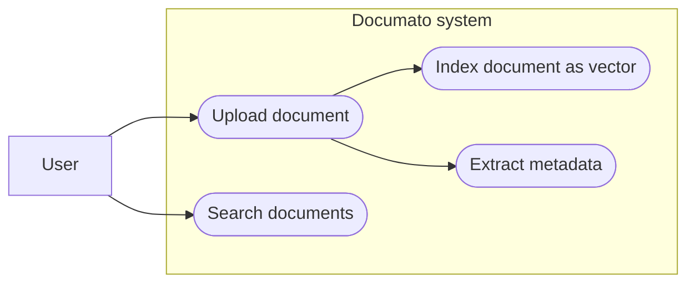

# Documato
Onkel Matos Document Search Engine.

## Use cases



## Local services

Build and start the ASP.NET Core web application, ARM64 Azure SQL Database
container, and ChromaDB with Docker Compose:

```bash
docker compose up -d --build
```

The services are available at:

- Documato.Web: `http://localhost:8080`
- Azure SQL Database: `localhost:1433`
- ChromaDB: `http://localhost:8000`

The web application is built using the .NET 10 SDK and runs as a non-root user
in the ASP.NET Core runtime image. Its [Dockerfile](src/Documato.Web/Dockerfile)
uses the repository root as the build context so all clean-architecture projects
are included. Container traffic uses HTTP on port 8080; HTTPS requires a separate
TLS configuration or reverse proxy.

The API scaffold does not yet define any endpoints, so an HTTP 404 at the root
URL is expected. Database and ChromaDB integration are not implemented yet.
When adding them, use `mssql:1433` and `http://chromadb:8000` inside the Compose
network, not `localhost`. Compose starts these services before the web container
but does not wait for them to become ready.

To rebuild the application after code changes:

```bash
docker compose up -d --build web
```

View application logs:

```bash
docker compose logs -f web
```

The database uses the `sa` user. The default development password is
`DocumatoDev!2026`; override it before starting the stack by setting
`MSSQL_SA_PASSWORD` in a `.env` file or in the shell environment.

The database image is a [public-preview Azure SQL Database engine](https://microsoft.github.io/azure-sql-dev-hub/container/get-started), not SQL Server 2022. It runs natively on ARM64 and uses a new `azure-sql-data` volume; any existing `mssql-data` volume from the previous image is left untouched.

Stop the containers without deleting their data:

```bash
docker compose down
```

To also remove the persisted database volumes:

```bash
docker compose down -v
```
